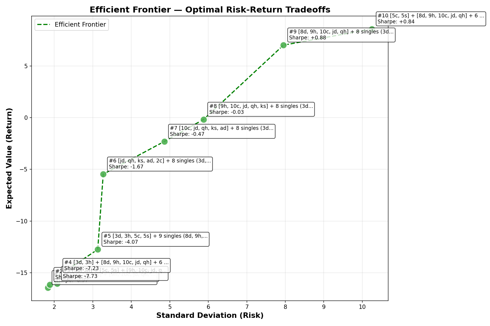

## Project Title

The Big 2 Portfolio Allocation: A Journey to Learn Portfolio Management by Monte Carlo Simulation through Big 2

## Project Goal

Driven by a desire to master foundational quantitative finance concepts, I built a Python-based Monte Carlo Simulation (MCS) framework. By treating the traditional card game Big 2 (鋤大D) as an asset allocation problem, this project explores how optimizing a 13-card hand directly mirrors managing financial portfolios in highly volatile markets.

## Background

Big 2 (鋤大D) is a popular Asian card game for four players. The goal is to play all your cards first. Players use single cards, pairs, or five-card hands like poker. The player with the 3 of diamonds goes first. The 2 is the highest card, and diamonds are the lowest suit.

I have always been curious about how to consistently win at Big 2 and whether there is a strategic approach to improving the win rate. 

This project aims to discover the optimal strategy for various in-game situations while documenting my personal learning journey.

## Takeaway

This project did not yield a 'perfect' or unbeatable card algorithm, because in systems dominated by human behavior, a perfect formula does not exist. The true value lies in mastering the methodology: applying financial theory to real-world problems through daily observation.

Furthermore, I leveraged AI to bridge the gap between my initial lack of programming expertise and the ability to generate functional code. Using AI helped me learn complex financial engineering concepts faster and more efficiently.

Finally, I realized that static formulas are inadequate for addressing these complex problems. Much like Wall Street, games like Big 2 are highly volatile, dynamic systems where outcomes are heavily influenced by the unpredictable, non-linear behavior of other participants. Consequently, evaluating a portfolio or a specific card combination solely by its win rate without accounting for maximum drawdown offers an incomplete measure of success. While Monte Carlo methods provide a foundational approach to portfolio evaluation, I am eager to explore advanced methodologies designed to navigate such complex environments.

## Learnings Summary 

1. ***Breaking the Code Barrier via "Vibe Coding":***

   I started this project with zero programming experience. By leveraging GitHub open-source repositories for basic game rules and relying on AI-assisted "Vibe Coding," I stitched together a high-performance simulation script. The journey was to learn core software architecture, data structures, and debugging through direct, iterative execution.

2. ***Monte Carlo Simulation***

   Through this project, I realized that arranging a 13-card hand is functionally identical to constructing a stock portfolio. I designed a Big 2 game engine to simulate game rules and calculate win rate, Expected Value, VaR(95%), standard deviation, and variance based on different card combinations.

3. ***Financial Theory Application to Big 2 Card Combinations***

      
   | Item | Stock Portfolio | Big 2 Card Game |
   |------|-----------------|-----------------|
   | Purpose |	Find the best stock portfolios |	Find the best card combinations |
   | Monte Carlo simulation |	Based on historical data to determine individual stock characteristics, such as variance, standard deviation, and correlation, or to slice different time periods to simulate portfolio performance |	Use game engine to simulate the output (e.g Win/Lost, Cards Left) of each card combination via many iterations |
   | Expected value | Stock portfolio gains and losses | Win: Sum of cards left in opponents' hands. Lose: Cards left in your hand  |
   | Sharpe ratio	| Calculate Sharpe ratio for different portfolios | Calculate Sharpe ratio for different card combinations |
   | Selection criteria	| Select portfolio with maximum gain based on acceptable risk | Select card combinations with maximum Expected Value based on acceptable risk |

4. ***Use of Modern Portfolio Theory***

    Used financial theory to select the optimal combination. The Big 2 card combination that maximizes return may not be the optimal choice. We need to consider risk tolerance. Analogous to efficient frontier theory, we choose the combination with an acceptable risk level. 
   
   Based on simulation results from [week7.md](./journey/week7.md), we selected combinations with higher return and acceptable risk. 

   
| Rank | Partition | EV | VaR(95%) | Sharpe | Interpretation |
|------|-----------|------|----------|--------|----------------|
| 1 | `[8d,9h,10c,jd,qh] + 8 singles` | +7.01 | **-4.00** | **+0.88** | **Best risk-adjusted** — lowest downside, excellent Sharpe |
| 2 | `[5c,5s] + [8d,9h,10c,jd,qh] + 6 singles` | **+8.57** | -16.00 | +0.84 | **Highest EV** — more return but 4× worse VaR than #1 |
| 3 | `[5c,5s] + [9h,10c,jd,qh,ks] + 6 singles` | +5.32 | -14.00 | +0.50 | **Good** — solid EV with moderate risk |
| 4 | `13 singles` | +0.77 | -12.00 | +0.08 | **Barely profitable** — essentially breakeven |
   
   Card combination `[8d,9h,10c,jd,qh] + 8 singles` is selected although it does not produce the maximum Expected Value (i.e., it only produces 7.01 compared with the highest 8.57), but it has the highest Sharpe ratio and the lowest VaR(95%) (-4). 

## Learning Journey

[Week 1](./journey/week1.md)

- **Game Rules & Constraint Logic:** Mastered the core rule matrices, hierarchy rankings, and discrete system mechanics governing Big 2 gameplay.
- **Combinatorial Probability Modeling:** Deployed mathematical formulas to calculate specific card distribution parameters and algorithmically identify impossible subsets or hand boundaries.
- **Stochastic Methodology Foundations:** Explored the structural principles of the Monte Carlo simulation framework to model game trees under uncertainty and optimize decision-making strategies.

[Week 2](./journey/week2.md)
- **Python Fundamentals:** Mastered syntax foundations, object-oriented programming concepts, and algorithmic control flows.
- **Script Prototyping:** Engineered baseline scripts to execute simple deterministic calculations and data structures.
- **Stochastic Analysis:** Explored Monte Carlo Python logic to model the empirical probabilities and distribution characteristics of complex Big 2 card combinations.

[Week 3](./journey/week3.md)
- **Generative AI Development:** Researched the paradigms of "vibe coding" and advanced prompt-driven software orchestration.
- **IDE & Tools Infrastructure:** Configured integrated development environments (IDEs), localized AI-assisted coding extensions, and version control tools.
- **Rapid Prototyping Execution:** Leveraged generative AI tooling to rapidly build and debug simple, reactive game-engine models.

[Week 4-5](./journey/week4-5.md)
- **Combinatorial Card Partitioning:** Algorithmic generation of all valid card combinations and potential hand partitions from a fixed starting hand.
- **Stochastic Game Engine Architecture:** Designed and implemented a discrete state-machine engine governing Big 2 rules, structural logic, and transition states.
- **Expected Value (EV) Modeling:** Formal mathematical modeling of the game’s utility function to calculate probability-weighted point returns rather than binary win rates.
- **Monte Carlo Simulation Optimization:** Development of an iterative stochastic loop framework to isolate the mathematically optimal card configuration across thousands of independent trials.
- **Quantitative Results Analysis:** Statistical evaluation of the simulation data to map out the Efficient Frontier and evaluate strategy performance under uncertainty.

[Week 6](./journey/week6.md)

- **Modern Portfolio Theory (MPT):** Researched the foundations of quantitative portfolio optimization, asset weighting frameworks, and the mathematics of the Efficient Frontier.
- **Quantitative Metrics Exploration:** Analyzed key financial risk parameters, including systemic variance, standard volatility measures, downside risk boundaries, and the Sharpe Ratio framework.
- **Asset-to-Card Allocation Mapping:** Formulated a structural cross-disciplinary mapping system to translate financial metrics directly into Big 2 card distribution parameters.

[Week 7](./journey/week7.md)
- **Application of Financial Theory:** Applied Modern Portfolio Theory and Quantitative Methods to the Big 2 card game.
- **Simulation Result Analysis:** Analyzed Big 2 card combination simulations through a financial lens.

  

## References

- [Big 2 Wiki](https://en.wikipedia.org/wiki/Big_two)
- [Big 2 mathematical formula calculation](https://github.com/BobSwagg13/Application-of-Combinatorics-in-Big-Two/blob/main/docs/Application%20of%20Combinatorics%20in%20Big%20Two.pdf)
