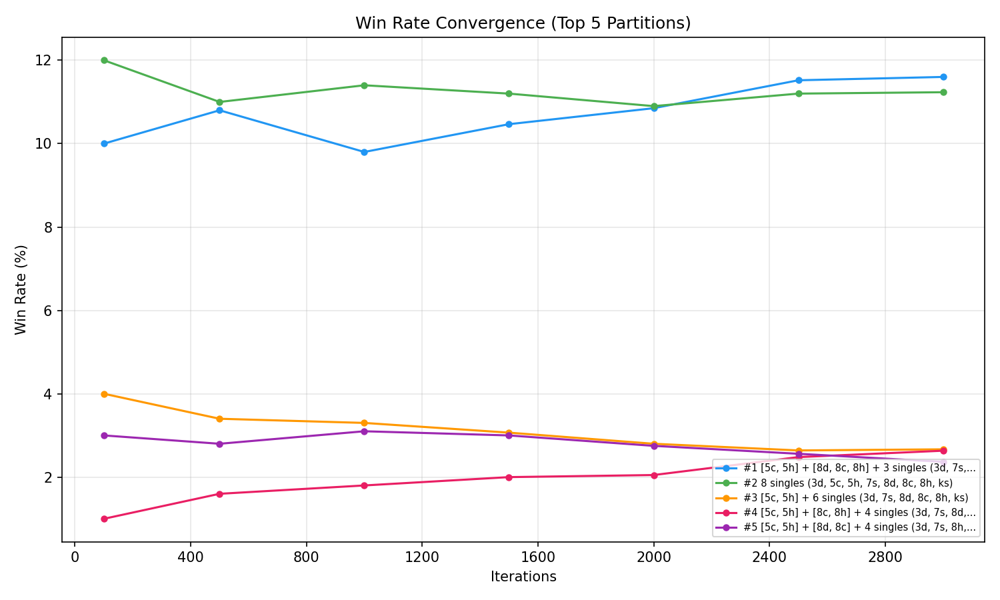
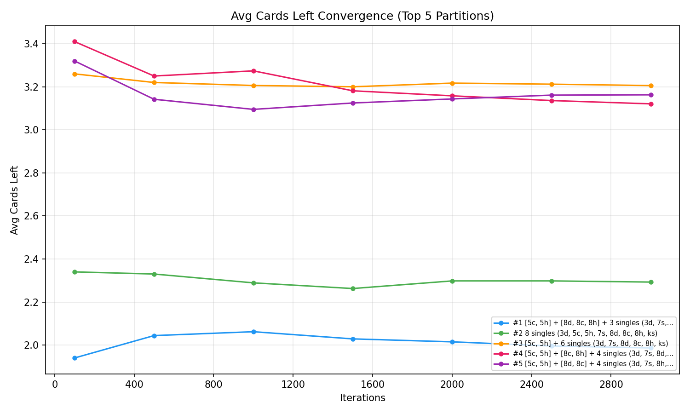
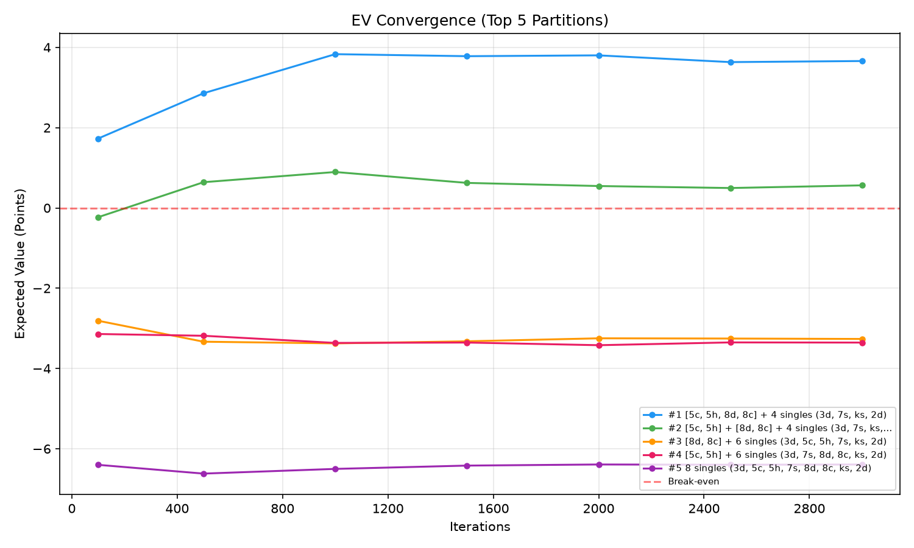
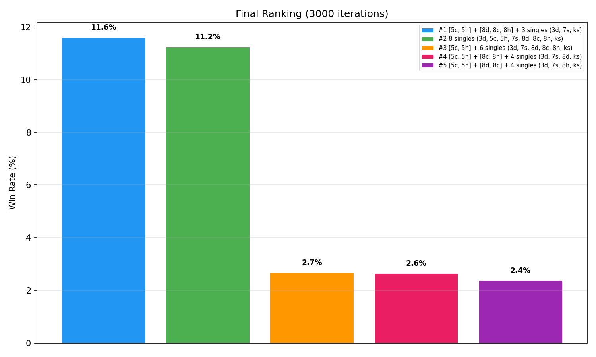

# Week 5 - Monte Carlo Simulation Program Code and Results

## Program Structure Overview

The Monte Carlo simulation engine is organized into 5 Python modules under `code/monte-carlos-analysis/`:

```
code/monte-carlos-analysis/
├── game_rule.py          # Card, Deck, Player classes and combination detection
├── partition_finder.py   # Partition enumeration logic
├── big2_game.py          # Game engine and play validation
├── big2_ai.py            # AI player implementations (SmartAI, RandomAI)
└── sim_play.py           # Monte Carlo simulation runner and visualization
```

Each module has a single responsibility, following the separation of concerns principle.

## Code Explanation

### 1. [game_rule.py](../code/monte-carlos-analysis/game_rule.py) - Card & Combination Engine

This module defines the fundamental card structures and provides methods to detect all valid Big 2 combinations from a hand.

**Key Classes:**
- `Card` - Represents a single card with value and suit
- `Deck` - Creates and manages a standard 52-card deck
- `Player` - Manages a player's hand and provides combination detection methods

**Core Functions:**

```python
def symbol_to_int(symbol):
    mapping = {'j': 11, 'q': 12, 'k': 13, 'a': 14, '2': 15}
    if symbol in mapping:
        return mapping[symbol]
    return int(symbol)
```

**Combination Detection Methods:**
- `exist_pair()` - Checks for any pair in hand
- `exist_straight()` - Checks for 5 consecutive cards
- `exist_flush()` - Checks for 5 cards of same suit
- `exist_full_house()` - Checks for triple + pair
- `exist_four_of_a_kind()` - Checks for 4 cards of same rank
- `exist_straight_flush()` - Checks for consecutive cards of same suit

**Combination Enumeration:**
- `pair_combinations()` - Returns all possible pairs
- `straight_combinations()` - Returns all possible straights (including special 3-4-5-A-2 and 3-4-5-6-2)
- `flush_combinations()` - Returns all possible flushes
- `full_house_combinations()` - Returns all possible full houses
- `four_of_a_kind_combinations()` - Returns all possible four-of-a-kinds
- `straight_flush_combinations()` - Returns all possible straight flushes

---

### 2. [partition_finder.py](../code/monte-carlos-analysis/partition_finder.py) - Partition (or Combinations) Enumeration

This module finds all valid ways to group a hand into legal Big 2 plays (partitions or combinations).

**Core Function:**

```python
def find_all_partitions(hand, max_partitions=5000):
    hand = sorted(hand, key=lambda c: (symbol_to_int(c[0]), {'d': 0, 'c': 1, 'h': 2, 's': 3}.get(c[1], 0)))
    results = []
    seen = set()
    _backtrack(hand, [], results, seen, max_partitions)
    return results
```

**How it works:**
1. `get_all_combos(hand)` - Generates all possible valid combinations from the hand (singles, pairs, triples, two pairs, straights, flushes, full houses, four-of-a-kinds, straight flushes)
2. `_backtrack()` - Recursively builds partitions by:
   - Selecting a non-single combo
   - Removing those cards from the remaining hand
   - Recursing until no cards remain
   - Backtracking to try different combinations
3. `_partition_key()` - Creates a canonical representation to avoid duplicate partitions

**Example Output:**
For hand `[3d, 5h, 5c, 7s, ks, 8d, 8c, 2d]`:
- `[5c,5h,8d,8c] + 4 singles` - two pair first
- `[5c,5h] + [8d,8c] + 4 singles` - two separate pairs
- `[5c,5h] + 6 singles` - one pair first
- `8 singles` - all individual cards

---

### 3. [big2_game.py](../code/monte-carlos-analysis/big2_game.py) - Game Engine

This module implements the core Big 2 game logic, including play validation and game simulation.

**Key Classes:**

```python
class PlayType(Enum):
    SINGLE = 1
    PAIR = 2
    TRIPLE = 3
    TWO_PAIR = 4
    STRAIGHT = 5
    FLUSH = 6
    FULL_HOUSE = 7
    FOUR_OF_A_KIND = 8
    STRAIGHT_FLUSH = 9

@dataclass
class Play:
    cards: List[Tuple[str, str]]
    play_type: PlayType
    rank_value: int = 0
    max_suit: int = 0
```

**Core Functions:**

```python
def can_beat(new_play, current_play):
    if new_play.play_type != current_play.play_type:
        return False
    if new_play.card_count() != current_play.card_count():
        return False

    if new_play.play_type == PlayType.TWO_PAIR:
        return compare_two_pair(new_play, current_play)

    if new_play.rank_value > current_play.rank_value:
        return True
    if new_play.rank_value == current_play.rank_value:
        return new_play.max_suit > current_play.max_suit
    return False
```

**Big2Game Class:**

```python
class Big2Game:
    def simulate_with_partition(self, partition_orders, ai_players):
        self.current_player = self.find_starting_player()
        # Game loop: each player takes a turn
        # - If holding 3d on the first round, must play it
        # - If leading, play first combo from partition
        # - If beating, find valid moves from partition
        # - If no valid move, pass
        # Game ends when someone has 0 cards or 200 turns are reached
        return self.winner, [len(h) for h in self.hands]
```

**Game Flow:**
1. Find starting player (holds 3d or random)
2. Each turn: player uses `choose_move_constrained()` to decide their action
3. Track pass count - when it reaches 3, round ends
4. Check winner after each play
5. Return winner index and remaining card counts

---

### 4. [big2_ai.py](../code/monte-carlos-analysis/big2_ai.py) - Computer Player

This module implements two AI players: SmartAI (strategic) and RandomAI (baseline).

**SmartAI - Strategic Player:**

```python
class SmartAI:
    def choose_move_constrained(self, hand, current_play, is_first_round, partition_remaining, game=None):
        valid_moves = self._get_valid_moves(hand, current_play, is_first_round)

        if not valid_moves:
            return None

        if is_first_round:
            must_have_3d = any(c == ('3', 'd') for c in hand)
            if must_have_3d:
                play_3d = Play([('3', 'd')], PlayType.SINGLE)
                if play_3d in valid_moves:
                    return play_3d

        if not partition_remaining:
            return None

        partition_plays = [Play(combo, identify_play_type(combo)) for combo in partition_remaining]

        if current_play is None:
            first_combo = partition_remaining[0]
            first_play = Play(first_combo, identify_play_type(first_combo))
            if first_play in valid_moves:
                return first_play
            return None

        valid_partition_plays = [pp for pp in partition_plays if pp in valid_moves]
        if valid_partition_plays:
            scored = []
            for move in valid_partition_plays:
                score = self._score_beat(move, hand, current_play)
                scored.append((score, move))
            scored.sort(key=lambda x: x[0])
            return scored[0][1]

        return None
```

**Scoring Logic:**

```python
def _score_lead(self, move, hand):
    score = 0
    card_values = [symbol_to_int(c[0]) for c in move.cards]
    max_val = max(card_values)
    score += max_val * 10  # Prefer lower cards

    # Prefer multi-card combos
    if move.play_type == PlayType.SINGLE:
        score += 0
    elif move.play_type == PlayType.PAIR:
        score -= 5
    elif move.play_type == PlayType.TRIPLE:
        score -= 10
    elif move.play_type == PlayType.TWO_PAIR:
        score -= 15
    elif move.play_type in (PlayType.STRAIGHT, PlayType.FLUSH, PlayType.FULL_HOUSE,
                            PlayType.FOUR_OF_A_KIND, PlayType.STRAIGHT_FLUSH):
        score -= 20

    # Rush to win when close
    cards_left = len(hand) - len(move.cards)
    if cards_left <= 3:
        score += 50

    # Save 2s for control
    has_2 = any(symbol_to_int(c[0]) == 15 for c in hand if c not in move.cards)
    if has_2:
        score -= 5

    return score
```

**Strategy Summary:**
- **Leading:** Play lowest cards first, group into combos, save 2s
- **Beating:** Pick cheapest winning move, avoid high cards unless necessary
- **Endgame:** When 3 cards left, rush to go out (score +50)

---

### 5. [sim_play.py](../code/monte-carlos-analysis/sim_play.py) - Monte Carlo Simulation Runner

This module orchestrates the entire simulation, running thousands of games and collecting statistics.

**Configuration:**

```python
PLAYER_HAND = [('3', 'd'), ('5', 'h'), ('5', 'c'), ('7', 's'), ('k', 's'), ('8', 'd'), ('8', 'c'), ('2', 'd')]
OPP_CARDS = 8
ITERATIONS = [100, 500, 1000, 1500, 2000, 2500, 3000]
TOP_N = 5
MAX_PARTITIONS = 500
```

**Core Simulation Function:**

```python
def run_sims_cumulative(player_hand, partition, total_sims, opp_cards):
    wins = 0
    total_cards_left = 0
    total_ev = 0
    milestones = {}
    current_milestone_idx = 0
    player_card_count = len(player_hand)

    for sim in range(1, total_sims + 1):
        deck = Deck()
        all_cards = [c for c in deck.cards if c not in player_hand]
        random.shuffle(all_cards)

        opponent_hands = []
        idx = 0
        for _ in range(3):
            opponent_hands.append(all_cards[idx:idx + opp_cards])
            idx += opp_cards

        ai_partitions = []
        for oh in opponent_hands:
            opp_partitions = find_all_partitions(oh, max_partitions=50)
            ai_partitions.append(random.choice(opp_partitions))

        all_partitions = [partition] + ai_partitions

        game = Big2Game(
            [player_hand] + opponent_hands,
            partition_orders=all_partitions,
        )
        ai_players = [SmartAI() for _ in range(4)]

        winner, cards_left = game.simulate_with_partition(all_partitions, ai_players)

        if winner == 0:
            wins += 1
            pi = sum(cards_left[1:])
        else:
            pi = -2 * cards_left[0]
        total_ev += pi
        total_cards_left += cards_left[0]

        while current_milestone_idx < len(ITERATIONS) and sim == ITERATIONS[current_milestone_idx]:
            milestones[sim] = (wins / sim, total_cards_left / sim, total_ev / sim)
            current_milestone_idx += 1

    milestones[total_sims] = (wins / total_sims, total_cards_left / total_sims, total_ev / total_sims)
    return milestones
```

**How it works:**
1. For each iteration (1 to 3000):
   - Shuffle remaining 24 cards and deal 8 to each opponent
   - Generate random partition for each opponent
   - Run full game simulation
   - Track wins, cards left, and EV
2. Record milestones at 100, 500, 1000, 1500, 2000, 2500, 3000 iterations
3. Return cumulative statistics for convergence analysis

**Visualization Functions:**
- `plot_convergence_winrate()` - Win rate over iterations
- `plot_convergence_cards()` - Average cards left over iterations
- `plot_convergence_ev()` - Expected value over iterations
- `plot_final_ranking()` - Final EV ranking bar chart
- `save_csv()` - Export results to CSV

---

## Simulation Results

### Example: One Simulation Iteration

Let's walk through a single game using the #1 partition `[5c,5h,8d,8c] + 4 singles`:

**Setup:**
- **Player 0 (you):** `[3d, 5h, 5c, 7s, ks, 8d, 8c, 2d]`
- **Player 1:** `[6d, 4d, 6c, qs, ah, 9d, qc, jd]` (randomly dealt)
- **Player 2:** `[4c, kc, 10c, 6h, qd, 9s, 6s, 10s]` (randomly dealt)
- **Player 3:** `[ad, ac, jh, 7d, 10h, 9h, 10d, js]` (randomly dealt)

**Opponent Partitions:**
- **Player 1:** `[qc, qs] + 6 singles (4d, 6d, 6c, 9d, jd, ah)`
- **Player 2:** `[10c, 10s] + 6 singles (4c, 6h, 6s, 9s, qd, kc)`
- **Player 3:** `[ad, ac] + 6 singles (7d, 9h, 10d, 10h, jh, js)`

**Game Play:**
1. **Turn 1:** Player 0 has 3d, must play it first → plays `3d` (single)
2. **Turn 2:** Player 1 plays `4d` (single) to beat 3d
3. **Turn 3:** Player 2 plays `4c` (single) to beat 4d
4. **Turn 4:** Player 3 plays `7d` (single) to beat 4c
5. **Turn 5:** Player 0 plays `7s` (single) to beat 7d
6. **Turn 6:** Player 1 plays `9d` (single) to beat 7s
7. **Turn 7:** Player 2 plays `9s` (single) to beat 9d
8. **Turn 8:** Player 3 plays `10d` (single) to beat 9s
9. **Turn 9:** Player 0 plays `ks` (single) to beat 10d
10. **Turn 10:** Player 1 plays `ah` (single) to beat ks
11. **Turn 11:** Player 2 passes
12. **Turn 12:** Player 3 passes
13. **Turn 13:** Player 0 plays `2d` (single) to beat ah → wins the round!
14. **Turn 14-16:** All players pass, round ends. Player 0 leads next round.
15. **Turn 17:** Player 0 leads → plays `5c,5h,8d,8c` (two pair) → **wins the game!**

**Result:**
- **Winner:** Player 0
- **Cards left:** Player 0: 0, Player 1: 5, Player 2: 6, Player 3: 6
- **Points earned:** 5 + 6 + 6 = **+17 points** (sum of opponents' remaining cards)

This single game is one iteration. The simulation repeats this 3,000 times with different opponent hands, then calculates the average win rate, cards left, and EV across all games.

## Overall Results

Running 3,000 iterations per partition (5 partitions × 3,000 = 15,000 total games, ~34 seconds) reveals a clear strategic hierarchy:

| Rank | Partition | Win Rate | Avg Cards Left | EV |
|------|-----------|----------|----------------|-------|
| 1 | `[5c,5h,8d,8c] + 4 singles` | **52.6%** | 1.98 | **+3.66** |
| 2 | `[5c,5h] + [8d,8c] + 4 singles` | 38.3% | 2.14 | +0.56 |
| 3 | `[8d,8c] + 6 singles` | 14.3% | 2.31 | -3.26 |
| 4 | `[5c,5h] + 6 singles` | 15.3% | 2.40 | -3.35 |
| 5 | `8 singles` | 1.4% | 3.27 | -6.39 |

## Analysis & Findings

### Evidence 1: Results Become Stable

The win rate graphs show lines that start jumping around at 100 games but settle down by 1500-2000 games. For example, the #1 partition's win rate goes up and down between 45% and 53% in the first 1000 games, then stays at about 52.6% after 1500 games. This proves the results are trustworthy - playing more games doesn't change the ranking; it just reduces random noise.



### Evidence 2: Cards Left Matches Win Rate

The top partition leaves only 1.98 cards on average, while the worst leaves 3.27. 



### Evidence 3: EV Shows Which Strategies Make Points

The EV chart also shows stability when the number of iterations increases. 



### Evidence 4: Clear Ranking by EV

The final ranking bar chart uses green bars for positive EV and red bars for negative EV, making it easy to see which strategies are profitable. 




### Final Takeaway

Monte Carlo simulation works because it tests each card grouping against many different opponent hands. Instead of guessing which grouping is best, you play thousands of realistic games and let the data show you the winner.

The graphs show that results become stable after enough games. The **Expected Value (EV) framework** is better than just looking at win rate because it accounts for risk. Instead of just asking "Do I win or lose?", EV tells us "How many points do I expect to win or lose on average?" This is similar to how investors evaluate portfolios—they don't just look at whether they win, but how much they win or lose on average.

