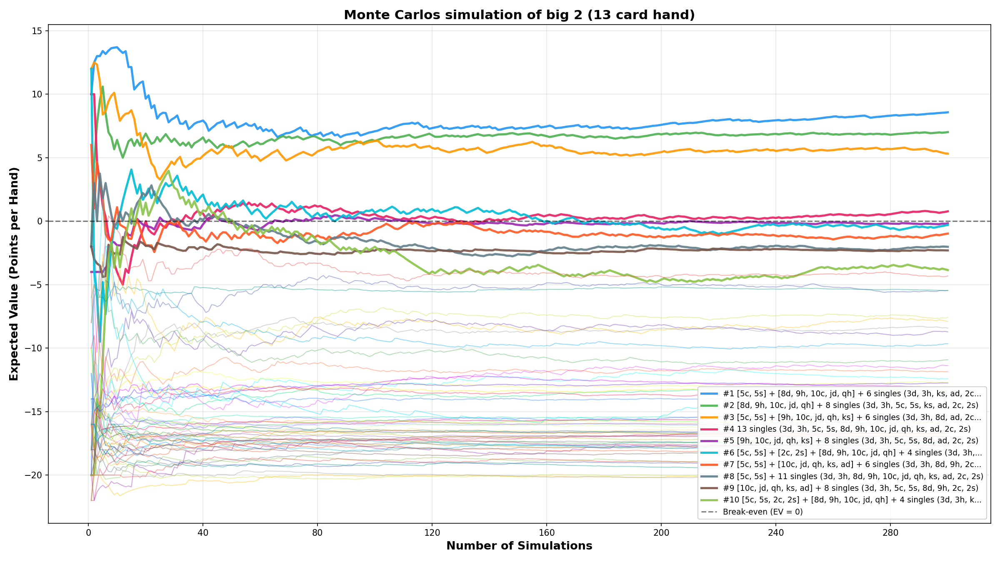
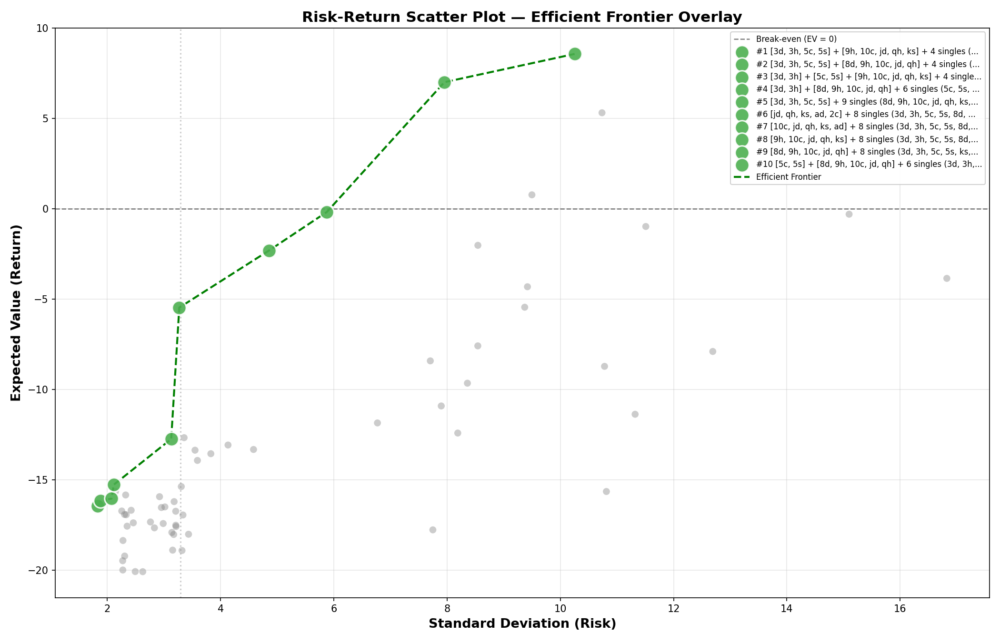
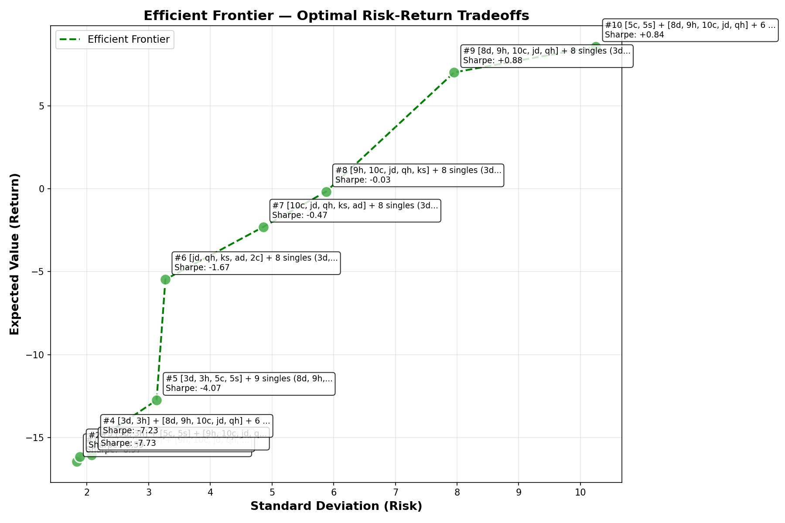
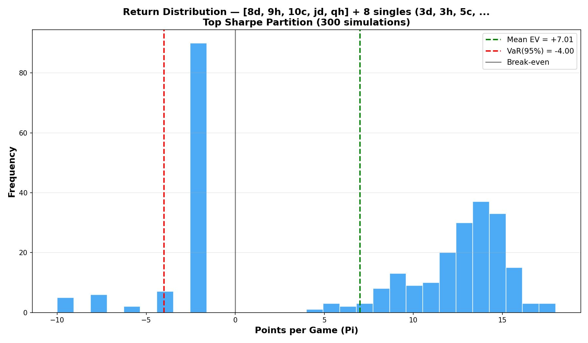
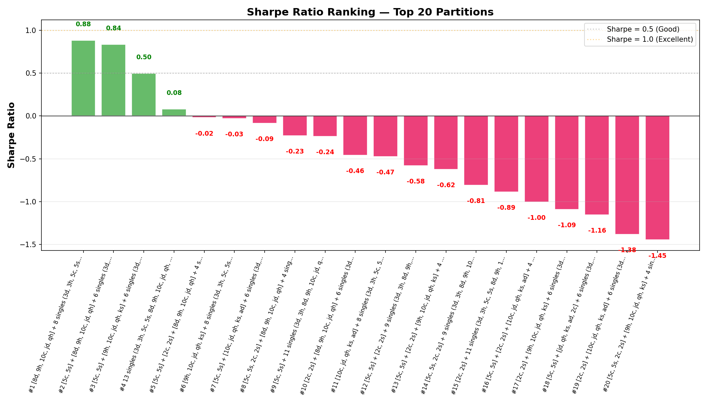

# Financial Analysis — Big 2 Monte Carlo Simulation

## Overview

Monte Carlo simulation framework for evaluating Big 2 starting hand combinations and determining optimal card arrangement strategies that maximize Expected Value (EV) and risk-adjusted returns.

### What is Expected Value (EV)?

EV measures the probability-weighted average of points won or lost per hand:

- **Win**: You gain points equal to the sum of opponents' remaining cards
- **Lose**: You lose points = `-2 × your remaining cards` (double penalty)

**Positive EV** means the strategy is profitable long-term. **Negative EV** means it loses points on average.

## Interpreting Combined Metrics

Each metric answers a different question. Use them together for optimal strategy selection:

| Metric | Answers | Decision Rule |
|--------|---------|---------------|
| **EV** | "Am I profitable long-term?" | Positive = worth playing |
| **VaR(95%)** | "How bad can it get?" | Closer to 0 = lower downside risk |
| **Sharpe** | "Is the return worth the risk?" | Higher = better risk-adjusted return |

### Sharpe Ratio Benchmarks

| Sharpe | Rating | Action |
|--------|--------|--------|
| > 1.0 | Excellent | Play confidently — high return, efficient risk |
| 0.5 – 1.0 | Good | Play with proper bankroll management |
| 0 – 0.5 | Marginal | Only play if no better option exists |
| < 0 | Losing | Avoid — negative return per unit of risk |

### Example from Simulation Results (300 simulations, fixed seed)

| Rank | Partition | EV | VaR(95%) | Sharpe | Interpretation |
|------|-----------|------|----------|--------|----------------|
| 1 | `[8d,9h,10c,jd,qh] + 8 singles` | +7.01 | **-4.00** | **+0.88** | **Best risk-adjusted** — lowest downside, excellent Sharpe |
| 2 | `[5c,5s] + [8d,9h,10c,jd,qh] + 6 singles` | **+8.57** | -16.00 | +0.84 | **Highest EV** — more return but 4× worse VaR than #1 |
| 3 | `[5c,5s] + [9h,10c,jd,qh,ks] + 6 singles` | +5.32 | -14.00 | +0.50 | **Good** — solid EV with moderate risk |
| 4 | `13 singles` | +0.77 | -12.00 | +0.08 | **Barely profitable** — essentially breakeven |

### VaR Interpretation

- **VaR(95%) = -6** → In 95% of games, your outcome is -6 or better (win or lose ≤6 points). Only 5% of games lose more than 6 points.
- **VaR(95%) = -24** → In 95% of games, your outcome is -24 or better. But in the worst 5% of games, you lose more than 24 points (catastrophic tail risk).
- **VaR close to 0** → The 5th percentile loss is small — even in bad scenarios, your bankroll is relatively safe.

### Decision Framework

1. **Filter by EV > 0** — eliminate all losing strategies
2. **Check VaR(95%)** — can your bankroll survive worst-case 5% scenarios?
3. **Pick highest Sharpe** — among viable options, maximize risk-adjusted return

## How It Works

1. **Partition Enumeration** — Finds every valid way to group the 13-card hand into legal Big 2 plays (e.g., pairs, straights, singles)
2. **Simulation Loop** — For each partition (66 total):
   - Deals 8 random cards to 3 opponents
   - Runs 300 full games with all players using SmartAI
   - Records each game's point outcome (Pi)
3. **Reproducibility** — Fixed random seed (`random.seed(42)`) ensures identical results across runs
4. **Ranking** — Sorts partitions by EV or Sharpe Ratio (descending)
5. **Visualization** — Generates convergence curves, scatter plots, histograms, bar charts, and Efficient Frontier

## Output

### EV Convergence [ev_convergence.py](../code/financial-analysis/ev_convergence.py)

- **Console**: Ranked summary table with Win Rate, Avg Cards Left, and EV
- **Graph**: `ev_convergence_all.png` — EV convergence lines for all partitions with top 10 highlighted

### Risk Analysis [risk_analysis.py](../code/financial-analysis/risk_analysis.py)

- **Console**: Ranked summary table with EV, Std Dev, VaR(95%), and Sharpe Ratio
- **Graphs**:
  - `risk_return_scatter.png` — Risk (Std Dev) vs Return (EV) scatter plot with Efficient Frontier overlay (green dashed line). Efficient partitions shown in green, inefficient in gray.
  
  - `efficient_frontier.png` — Clean view showing only the optimal partitions on the frontier curve, labeled with Sharpe Ratio.
  
  - `risk_histogram.png` — Return distribution histogram for the top Sharpe partition with VaR marker
  
  - `sharpe_bar_chart.png` — Sharpe Ratio ranking bar chart for top 20 partitions
  

### Efficient Frontier

The **Efficient Frontier** (from Modern Portfolio Theory) identifies the set of **optimal partitions** offering the best expected return for a given level of risk. A partition is on the frontier if no other partition provides:
- Higher EV for the same or lower risk, OR
- Lower risk for the same or higher EV

Partitions **below the frontier** are **inefficient** — you can achieve higher returns without accepting additional risk.

**Strategic Insight**: Choose partitions on the efficient frontier for optimal risk-adjusted returns. The frontier curve shows the maximum achievable EV at each risk level.

## Takeaway

### EV Tells You What You Earn. Sharpe Tells You What It Costs.

Week 4 established that Expected Value determines profitability. Week 7 adds **risk-adjusted return analysis** using Sharpe Ratio and VaR — the same framework portfolio managers use to evaluate investments.

### Three-Layer Decision Framework

| Layer | Question | Example from Results |
|-------|----------|---------------------|
| **EV > 0** | Is this profitable? | 4 partitions pass (EV +0.77 to +8.57) |
| **VaR(95%)** | Can I survive the worst 5%? | Partition #1 (VaR -4) is 4× safer than #2 (VaR -16) |
| **Sharpe Ratio** | Is the return worth the risk? | Partition #1 (Sharpe 0.88) beats #2 (Sharpe 0.84) |

### Key Findings

**VaR reveals what EV hides** — Partition #2 has higher EV (+8.57 vs +7.01) but 4× worse VaR (-16 vs -4). This means #2 wins bigger on average but has much worse downside risk. In finance terms: **higher return, higher tail risk**.

**The Efficient Frontier shows the tradeoff** — Both partitions #1 and #2 are on the frontier, meaning neither is dominated. The choice depends on risk tolerance:
- **Aggressive play** → Partition #2 `[5c,5s] + [8d,9h,10c,jd,qh] + 6 singles` (maximize EV at +8.57)
- **Conservative play** → Partition #1 `[8d,9h,10c,jd,qh] + 8 singles` (minimize risk at VaR -4)

**Reproducibility matters** — With fixed random seed, both scripts now produce identical EV values (e.g., +8.57 for partition #2), eliminating Monte Carlo variance between runs.