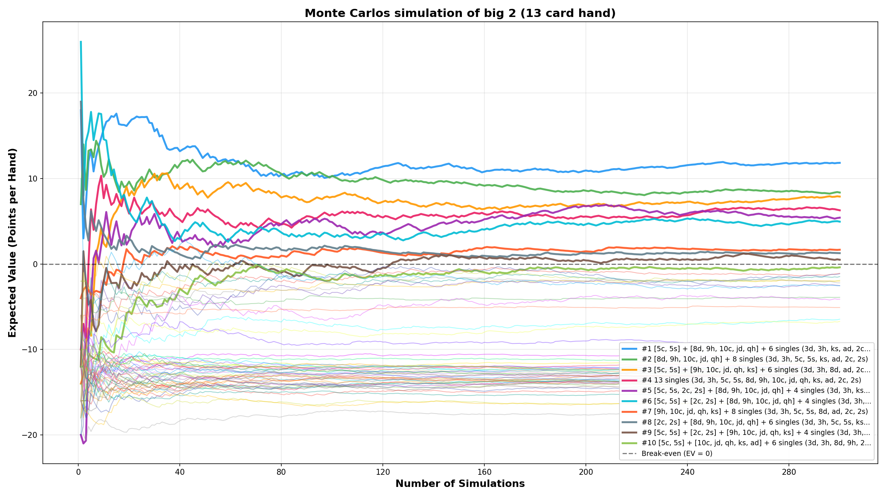
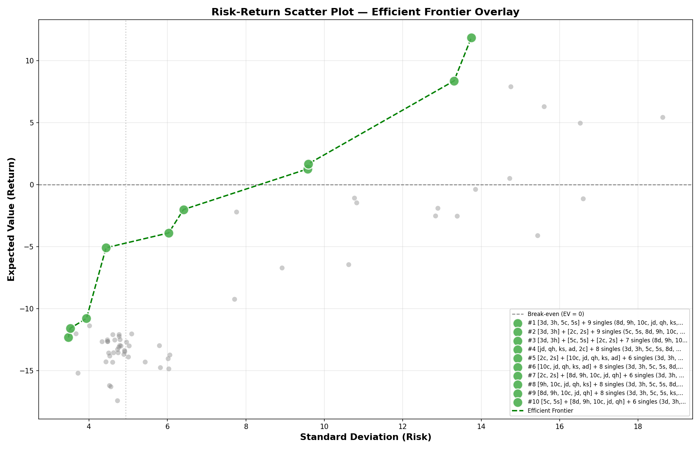
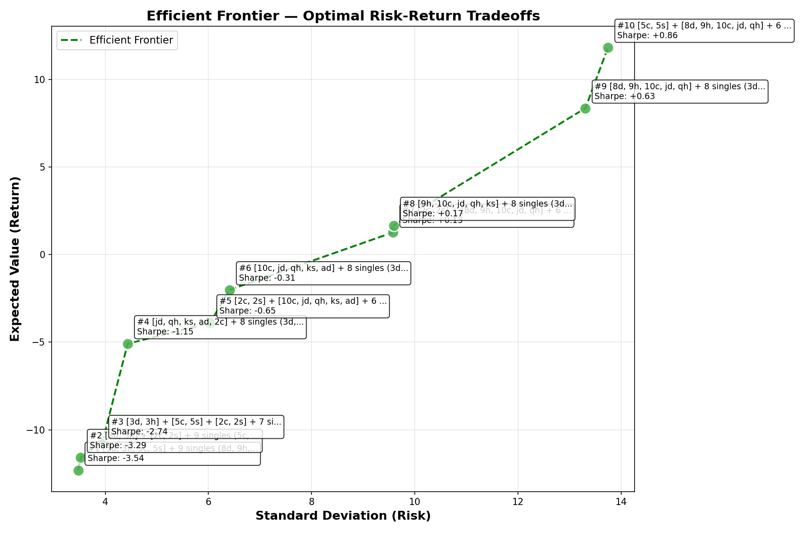
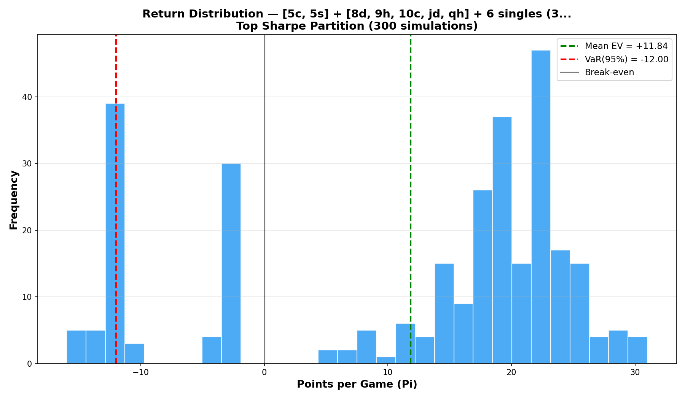
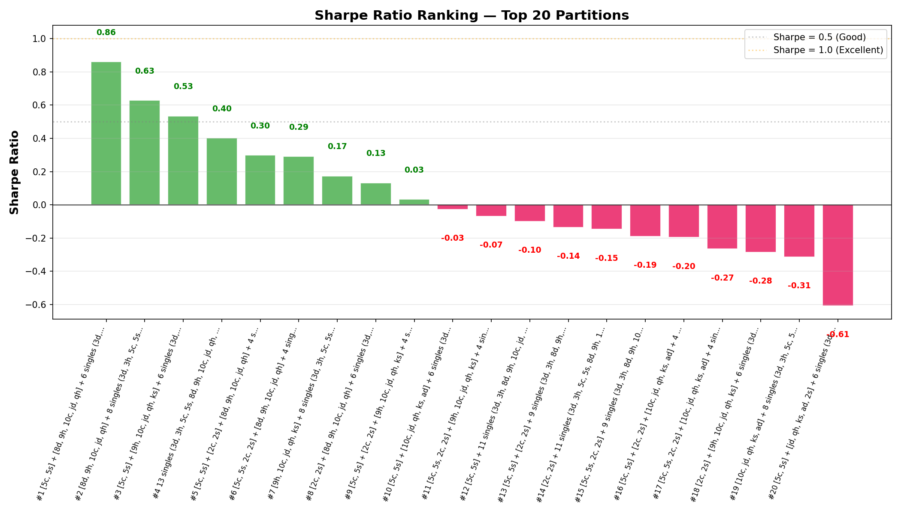

# Week 8 - Financial Analysis Results and Findings

## Interpreting Combined Metrics

Each metric answers a different question. Use them together for optimal strategy selection:

| Metric | Answers | Decision Rule |
|--------|---------|---------------|
| **EV** | "Am I profitable long-term?" | Positive = worth playing |
| **VaR(95%)** | "How bad can it get?" | Closer to 0 = lower downside risk |
| **Sharpe** | "Is the return worth the risk?" | Higher = better risk-adjusted return |

### Sharpe Ratio Benchmarks

| Sharpe | Rating | Action |
|--------|--------|--------|
| > 1.0 | Excellent | Play confidently — high return, efficient risk |
| 0.5 – 1.0 | Good | Play with proper bankroll management |
| 0 – 0.5 | Marginal | Only play if no better option exists |
| < 0 | Losing | Avoid — negative return per unit of risk |

## Simulation Results

### Test Hand Configuration

The simulation evaluates how to optimally arrange this specific 13-card hand:
- **Hand:** `[3d, 3h, 5c, 5s, 8d, 9h, 10c, jd, qh, ks, ad, 2c, 2s]`

### Example from Simulation Results (300 simulations, fixed seed, 13 cards per opponent)

| Rank | Partition | EV | VaR(95%) | Sharpe | Interpretation |
|------|-----------|------|----------|--------|----------------|
| 1 | `[5c,5s] + [8d,9h,10c,jd,qh] + 6 singles` | **+11.84** | -12.00 | **+0.86** | **Best risk-adjusted** — highest EV with good Sharpe |
| 2 | `[8d,9h,10c,jd,qh] + 8 singles` | +8.37 | **-6.00** | +0.63 | **Lowest risk** — best VaR, conservative choice |
| 3 | `[5c,5s] + [9h,10c,jd,qh,ks] + 6 singles` | +7.89 | -14.00 | +0.53 | **Good** — solid EV with moderate risk |
| 4 | `13 singles` | +6.29 | -14.00 | +0.40 | **Profitable** — all singles strategy works |

### VaR Interpretation

- **VaR(95%) = -6** → In 95% of games, your outcome is -6 or better (win or lose ≤6 points). Only 5% of games lose more than 6 points.
- **VaR(95%) = -24** → In 95% of games, your outcome is -24 or better. But in the worst 5% of games, you lose more than 24 points (catastrophic tail risk).
- **VaR close to 0** → The 5th percentile loss is small — even in bad scenarios, your bankroll is relatively safe.

### Decision Framework

1. **Filter by EV > 0** — eliminate all losing strategies
2. **Check VaR(95%)** — can your bankroll survive worst-case 5% scenarios?
3. **Pick highest Sharpe** — among viable options, maximize risk-adjusted return

## Output & Visualizations

### EV Convergence

The EV convergence graph shows how Expected Value stabilizes as more simulations run.

The top partitions converge quickly, showing that 300 simulations are sufficient for reliable estimates.

### Risk-Return Scatter Plot

The scatter plot shows all 66 partitions with risk (Standard Deviation) on the x-axis and return (EV) on the y-axis. The Efficient Frontier is overlaid as a green dashed line.

Green dots represent efficient partitions. Gray dots represent inefficient partitions that are dominated by better options.

### Efficient Frontier

The Efficient Frontier shows only the optimal partitions that offer the best expected return for a given level of risk.

Each point is labeled with its Sharpe Ratio. The frontier curve shows the maximum achievable EV at each risk level.

### Return Distribution Histogram

The histogram shows the distribution of outcomes (points per game) for the top Sharpe partition.

The green line shows the mean EV. The red line shows VaR(95%) — the worst outcome in 95% of games.

### Sharpe Ratio Ranking

The bar chart ranks the top 20 partitions by Sharpe Ratio.

Green bars represent positive Sharpe Ratios. The horizontal lines show benchmarks: 0.5 (Good) and 1.0 (Excellent).

## Efficient Frontier

The **Efficient Frontier** (from Modern Portfolio Theory) identifies the set of **optimal partitions** offering the best expected return for a given level of risk. A partition is on the frontier if no other partition provides:
- Higher EV for the same or lower risk, OR
- Lower risk for the same or higher EV

Partitions **below the frontier** are **inefficient** — you can achieve higher returns without accepting additional risk.

**Strategic Insight**: Choose partitions on the efficient frontier for optimal risk-adjusted returns. The frontier curve shows the maximum achievable EV at each risk level.

## Takeaway

### EV Tells You What You Earn. Sharpe Tells You What It Costs.

Week 4 established that Expected Value determines profitability. Week 7 adds **risk-adjusted return analysis** using Sharpe Ratio and VaR — the same framework portfolio managers use to evaluate investments.

### Three-Layer Decision Framework

| Layer | Question | Example from Results |
|-------|----------|---------------------|
| **EV > 0** | Is this profitable? | 9 partitions pass (EV +1.27 to +11.84) |
| **VaR(95%)** | Can I survive the worst 5%? | Partition #2 (VaR -6) is 2× safer than #1 (VaR -12) |
| **Sharpe Ratio** | Is the return worth the risk? | Partition #1 (Sharpe 0.86) beats #2 (Sharpe 0.63) |

### Key Findings

**Grouping cards into a straight is powerful** — Partition #1 `[5c,5s] + [8d,9h,10c,jd,qh] + 6 singles` has the highest EV (+11.84) and best Sharpe ratio (+0.86). The straight `[8d,9h,10c,jd,qh]` clears 5 cards in one turn, giving a significant advantage.

**VaR reveals risk differences** — Partition #2 `[8d,9h,10c,jd,qh] + 8 singles` has lower EV (+8.37 vs +11.84) but 2× better VaR (-6 vs -12). This means #2 has much less downside risk. In finance terms: **lower return, lower tail risk**.

**The Efficient Frontier shows the tradeoff** — Both partitions #1 and #2 are on the frontier, meaning neither is dominated. The choice depends on risk tolerance:
- **Aggressive play** → Partition #1 `[5c,5s] + [8d,9h,10c,jd,qh] + 6 singles` (maximize EV at +11.84)
- **Conservative play** → Partition #2 `[8d,9h,10c,jd,qh] + 8 singles` (minimize risk at VaR -6)

**13-card simulation is more realistic** — With 13 cards per opponent (standard Big 2 rules), the EV values are higher because there are more points at stake. The simulation takes ~17 minutes instead of ~2 minutes, but provides more accurate results.

**Reproducibility matters** — With fixed random seed, both scripts produce identical EV values (e.g., +11.84 for partition #1), eliminating Monte Carlo variance between runs.

## Reference

- [1] [Explanation of efficient frontier](https://www.youtube.com/watch?v=vnAbsNN3SbA)
- [2] [What is an Efficient Frontier](https://corporatefinanceinstitute.com/resources/capital_markets/efficient-frontier/)
- [3] [Understanding the Efficient Frontier: Risk vs. Return](https://www.youtube.com/watch?v=5gsafk5IAIw)
